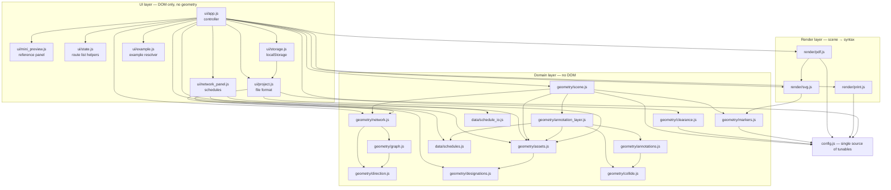
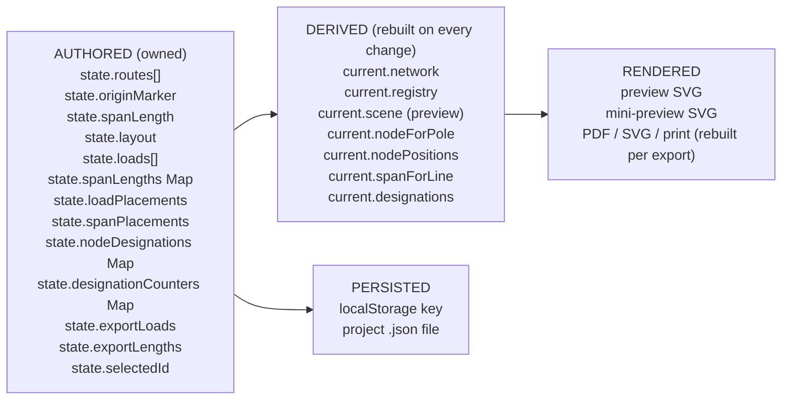
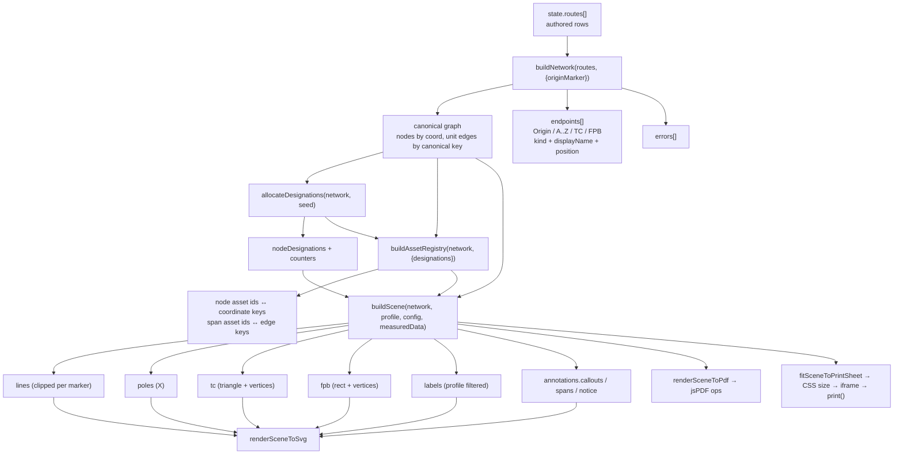

# Technical architecture

This document describes the application from startup to export: which module owns
what, how state flows, and where the contracts are enforced. It is the document to
read before changing code.

## Contents

1. [Entry points and startup](#1-entry-points-and-startup)
2. [Layered view](#2-layered-view)
3. [Module responsibility matrix](#3-module-responsibility-matrix)
4. [State ownership](#4-state-ownership)
5. [The end-to-end route processing pipeline](#5-the-end-to-end-route-processing-pipeline)
6. [The shared normalized scene](#6-the-shared-normalized-scene)
7. [Interface contracts](#7-interface-contracts)
8. [Dependency rules](#8-dependency-rules)
9. [Refresh and invalidation model](#9-refresh-and-invalidation-model)

---

## 1. Entry points and startup

### The HTML shell

[index.html](../index.html) is the only page. It loads, in order:

1. `vendor/jspdf/jspdf.umd.cjs` — a classic script that defines `window.jspdf.jsPDF`.
2. `styles/app.css`.
3. `<script type="module" src="src/ui/app.js">` — the application.

All DOM the controller touches is present in the markup; the controller only fills
tables, the dropdown and the canvas.

### Boot sequence

[src/ui/app.js](../src/ui/app.js) runs `boot()` on `DOMContentLoaded` (or
immediately if the document is already parsed):

```mermaid
sequenceDiagram
    participant HTML
    participant App as app.js
    participant State as state.js
    participant Panel as network_panel.js
    participant Store as storage.js
    participant Proj as project.js

    HTML->>App: module executes
    App->>App: lookup DOM (dom map), createState()
    App->>App: setupEventListeners()
    App->>App: setupPreviewInteraction()
    App->>Panel: createNetworkPanel({getState, getNetwork, onChange, notify, onSelectNode, onSelectSpan})
    App->>App: set spacing/layout/origin selectors from state
    App->>App: refresh()  (recompute + render with an empty route list)
    App->>Store: loadFromStorage()
    alt status "ok"
        Store->>Proj: parseProjectJson(raw)
        Proj-->>Store: validated project
        App->>App: applyProject(project) → refresh({refit:true}) → restored
    else status "invalid"
        App->>App: recoveryPending = true; showRecovery(); loadExample() → recovery
    else status "unavailable"
        App->>App: persistenceNotice = message; loadExample() → unavailable
    else status "none"
        App->>App: loadExample() → empty
    end
```

The four startup outcomes (`restored`, `empty`, `unavailable`, `recovery`) are the
ones documented in [Persistence](05-persistence.md#6-startup-and-recovery).

## 2. Layered view

Four layers, with dependencies pointing strictly downward:



Key properties:

- **Nothing in `src/geometry/` or `src/data/` touches the DOM**, which is why the
  whole domain is testable under `node --test` without a browser.
- **The render layer imports the scene shape, never the graph.** `render/svg.js` and
  `render/pdf.js` do no network geometry at all; `render/pdf.js` imports only
  `poleCrossPath` and `tcTrianglePoints` from `render/svg.js` so the X and the
  triangle have one definition of their path data.
- **The UI imports geometry, never the reverse.**

## 3. Module responsibility matrix

| Module | Responsibility | Inputs | Outputs | Dependencies |
| --- | --- | --- | --- | --- |
| [src/config.js](../src/config.js) | Directions, direction aliases, render profiles, page layouts, every tunable dimension, the bundled example | — | `DIRECTIONS`, `DIRECTION_ALIASES`, `RENDER_PROFILES`, `MARKER_KINDS`, `PAGE_LAYOUTS`, `DEFAULT_CONFIG`, `EXAMPLE_ROUTES`, `createConfig()`, `cssFormatName()`, `cssOrientationName()` | none |
| [geometry/direction.js](../src/geometry/direction.js) | Canonical direction keys, unit vectors, coordinate arithmetic, coordinate keys | direction text, coordinates | `{dx,dy}`, new coordinates, `"x,y"` keys | config |
| [geometry/graph.js](../src/geometry/graph.js) | Canonical grid graph: nodes by coordinate, undirected unit edges merged by canonical key, provenance | coordinates, provenance | `nodes: Map`, `edges: Map` | direction |
| [geometry/network.js](../src/geometry/network.js) | Sequential instruction processing, validation, endpoint registry, naming projection, bounding box | route list, `{origin, originMarker}` | `{ok, graph, routes, errors, endpoints, boundingBox, tcCount, fpbCount, alphaCount, originPosition, originMarker}` | direction, graph |
| [geometry/assets.js](../src/geometry/assets.js) | Stable asset ids for nodes and spans; registry that bridges coordinate keys and asset ids; reconciliation | network, optional designations | `buildAssetRegistry()`, `reconcile()`, id builders, `spanAssetId()` | designations |
| [geometry/designations.js](../src/geometry/designations.js) | Reads-out-loud point names and span display names; per-source counters; reservation of used names | network, seed designations+counters | `{nodeDesignations, counters, sourceOf}`, `spanDesignation()` | none |
| [geometry/markers.js](../src/geometry/markers.js) | Marker outlines (TC triangle, FPB rectangle), pixel-space direction vectors, polygon clipping | marker primitives | vertices, `points` strings, clipped segment list | config |
| [geometry/clearance.js](../src/geometry/clearance.js) | Derives the minimum workable span spacing from marker sizes | config overrides | `requiredSpanLength()`, `requiredClearanceDistance()`, `checkSpanClearance()`, message | config |
| [geometry/collide.js](../src/geometry/collide.js) | Box/segment overlap tests used by annotation placement | boxes, segments | booleans, overlap area, inflated box | none |
| [geometry/annotations.js](../src/geometry/annotations.js) | Candidate positions, text measurement, callout/span-label placement, leader and arrowhead geometry | node/span positions, obstacles, bounds, manual offsets | placement + annotation records | collide |
| [geometry/annotation_layer.js](../src/geometry/annotation_layer.js) | Builds all annotations for a scene, in a fixed order, applying the profile's export switches and the completeness notice | network, profile, config, placed primitives, measured data | `{callouts, spans, obstacles, notice, completeness}` | annotations, collide, assets, schedules |
| [geometry/scene.js](../src/geometry/scene.js) | Builds the normalized pixel-space scene: lines, poles, TC, FPB, labels, annotations, metrics | network, profile, config overrides, measured data | scene object | config, network, assets, markers, annotation_layer, schedules |
| [data/schedules.js](../src/data/schedules.js) | Load records and span-length measurements as pure data with validation; no totals, no conversions | loads/existing maps, raw values | new lists/maps, verdicts, callout lines | — |
| [data/schedule_io.js](../src/data/schedule_io.js) | CSV/TSV parse and format, staged import plans, apply functions | text, current data, lookup functions | rows, plans `{added, updated, unchanged, removed, unresolved}`, refusal `{code, message, details}` | schedules |
| [render/svg.js](../src/render/svg.js) | Scene → SVG string, editable primitives, escaping, X path, TC points | scene, options | SVG markup | markers |
| [render/pdf.js](../src/render/pdf.js) | Scene → jsPDF vector document; fit-to-page transform | scene, `{jsPDF, layout, margin, compress}` | `{doc, fit, layout, primitives}` | config, svg |
| [render/print.js](../src/render/print.js) | Fit a scene onto one sheet of a layout, aspect preserved | scene size, layout, margin mm | `{widthMm, heightMm, scale, boxWidthMm, boxHeightMm}` | config |
| [ui/state.js](../src/ui/state.js) | Owns the authored route list shape, route ids, dropdown availability, Origin label | route list, index, origin marker | `createState()`, `createRoute()`, `availableSources()`, `sourcesForRow()`, `latestSource()`, `endpointLabel()` | network, schedules |
| [ui/project.js](../src/ui/project.js) | The versioned file format: serialise, validate, migrate, compare | live project / document text | document object, validated project, refusals | config, network, assets, schedules |
| [ui/storage.js](../src/ui/storage.js) | The `localStorage` key and every failure mode of it | live project | outcomes `{ok｜none｜invalid｜unavailable}` | project |
| [ui/example.js](../src/ui/example.js) | Resolves authored display-name references to internal ids | `EXAMPLE_ROUTES`, id factory | instruction list | network, direction |
| [ui/mini_preview.js](../src/ui/mini_preview.js) | The reference copy: fitted `viewBox`, designation overlay, selection ring | scene, node assets, positions | SVG markup | — |
| [ui/network_panel.js](../src/ui/network_panel.js) | The two schedules: render, add/remove/reassign, CSV/TSV, staged import, unresolved bar, selection | callbacks into `app.js` | DOM and `onChange` calls | schedules, schedule_io, assets |
| [ui/app.js](../src/ui/app.js) | Controller: DOM, events, viewport, exports, persistence gating, recompute | everything above | DOM, downloads, storage writes | all of the above |

## 4. State ownership



Rules the implementation follows:

- **Only `state` is authoritative.** There is no second copy of the network to keep
  in sync: `current` is rebuilt from scratch by `recompute()` on every change.
- **Exports are pure functions of authored state.** Every export calls `buildScene()`
  again with its own profile; it never reuses the preview scene. That is what makes
  the two export switches and the per-profile label rules correct at the moment of
  export.
- **The Network data panel owns no copy of the data.** It reads through `getState()`
  and writes back through `onChange(patch)`, which forwards to
  `applyMeasuredChange()` in `app.js`.
- **The scene is the single rendering contract.** No renderer computes a coordinate.
- **`state.selectedId`** is UI state and is deliberately *not* persisted.
- **Point designations are authored, not derived.** They are stored in
  `state.nodeDesignations` and only ever extended; `allocateDesignations()` is seeded
  with them so a reload cannot renumber a pole.

## 5. The end-to-end route processing pipeline



### Stage by stage

1. **Instruction list** (`state.routes`). Authored rows in user order, each with a
   stable `route-N` id.
2. **Validation and graph construction** (`buildNetwork`). The rows are walked in
   order; a registry of endpoints resolves each `from`; each span becomes one unit
   edge; failures are collected as `errors[]` and never silently drop a row.
3. **Designation allocation** (`allocateDesignations`). Names every pole from the
   named point it grows out of, seeded by the designations already stored.
4. **Asset registry** (`buildAssetRegistry`). Maps each drawn coordinate to an
   immutable asset id and each edge to a canonical span id, and back again.
5. **Scene building** (`buildScene`). Converts grid coordinates into pixels, produces
   marker primitives *first*, clips every line against every marker, then places
   labels and finally the annotation layer.
6. **Rendering.** The prototype is `lines → poles → tc → fpb → labels → span labels
   → callouts → notice`, in that z-order, in all three outputs.

## 6. The shared normalized scene

`buildScene()` is the only thing any renderer consumes. The scene is a plain object
in pixel space; it holds no DOM, no canvas and no PDF knowledge.

```js
{
  profile,          // the resolved RENDER_PROFILES entry
  config,           // the resolved config (DEFAULT_CONFIG + overrides)
  bbox,             // integer grid bounding box {minX, minY, maxX, maxY}
  width, height,    // scene size in px (content + padding)
  padding,          // px padding used (viewPadding for preview, exportPadding otherwise)
  spanLength,       // px per span, echoed for callers/tests
  fontFamily,

  lines:  [{ id, parentId, x1, y1, x2, y2, strokeWidth, sources }],
  poles:  [{ id, x, y, size, degree }],
  tc:     [{ id, x, y, halfWidth, height, name, direction }],
  fpb:    [{ id, x, y, width, height, text, name, fontSize, boxX, boxY }],
  labels: [{ id, kind: 'origin'|'alpha', x, y, text, anchor, fontSize, offsetX, offsetY }],
  junctions: [],    // present but empty: showJunctionMarkers is false in every profile

  annotations: {
    callouts: [{ id, kind:'load', assetId, lines[], center, side, candidateIndex,
                 collisions, manual, fontSize, leader:{...}, arrow:{...} }],
    spans:    [{ id, kind:'span', assetId, lines[], center, side, candidateIndex,
                 collisions, manual, fontSize, a, b, measured }],
    obstacles: [...],
    notice:    null | { id, text, center, size, fontSize, boxes },
    completeness: { total, measured, unmeasured }
  },
  hasVisibleText
}
```

### How the three outputs avoid reconstructing geometry

| Concern | Where it is decided | Who reads it |
| --- | --- | --- |
| Where a pole is | `gridToPixel()` inside `buildScene` | every renderer, verbatim |
| Where a line stops at a TC/FPB | `clipSegmentOutsidePolygon()` inside `buildScene` | every renderer, verbatim (`lines[].x1..y2`) |
| The TC triangle's three points | `tcTriangleVertices()` in `markers.js`, through `tcTrianglePoints()` | SVG emits `<polygon points>`, PDF emits three segments through the same transform |
| The FPB box corners | `createFpbPrimitive()` in `scene.js` | SVG `<rect>`, PDF `doc.rect`, and the clipping (`fpbRectVertices`) |
| Where a callout sits and what it says | `buildAnnotationLayer()` | SVG `<g id="callout:…">`, PDF lines + polygon + text |
| Which labels are visible | the profile flags | `labels[]` is already filtered; SVG/PDF draw whatever is there |
| Whether loads/lengths are shown | `profile.showNodeLoads` / `showSpanLengths`, applied **once** inside the annotation layer | both renderers |
| How big the drawing is on paper | `fitSceneToPage()` (PDF) and `fitSceneToPrintSheet()` (print) | one transform each, scene pixels in, page units out |

The PDF renderer's own header states the contract: *"It performs no network geometry
of its own: no pole positions, no junctions, no endpoint coordinates are calculated
here. The only arithmetic is a uniform aspect-preserving fit from scene pixels into
the page box."*

The regression history that makes this contract a hard rule — the TC triangle drawn
at the wrong scale in the PDF, and the print sheet sized by content width — is in
[Rendering and export](07-rendering-and-export.md#6-regression-history).

## 7. Interface contracts

These are the contracts other modules may rely on. Each is enforced by tests.

### `buildNetwork(routes, options) → network`

- `routes` is consumed in order; order is semantic.
- `network.ok` is true iff `errors` is empty.
- `network.routes[i]` corresponds **positionally** to `routes[i]` and is
  `{routeId, row, ok, sourceId?, destinationId?, destinationName?, path?}` or
  `{routeId, row, ok:false, error:code}`.
- `network.endpoints[]` is `{id, name, kind: 'origin'|'endpoint'|'tc'|'fpb', position,
  usedAsSource, createdByDirection, displayName}`.
- `network.graph.nodes` is keyed by `"x,y"`; `network.graph.edges` is keyed by the
  canonical sorted endpoint pair.
- A node records `{id, key, x, y, neighbors:Set, isOrigin, alphaLabel, tcId, tcName,
  fpbId, fpbName, markerDirection}`.
- Each edge is `{key, a, b, sources:[{routeId, row, fromId, direction, spanIndex, fromKey}]}`.
- `network.ok === false` never throws; errors are data.

### `buildAssetRegistry(network, {designations}) → registry`

- `nodeIds: Map<coordKey, assetId>`, `nodeKeys: Map<assetId, coordKey>`,
  `edgeIds: Map<edgeKey, spanId>`, `edgeAliases: Map<candidateId, canonicalId>`.
- `nodeAsset(id)`, `edgeAsset(id)` (alias-resolving), `allNodeAssets()`,
  `allSpanAssets()`, `canonicalSpanId()`, `canonicalNodeId()`.
- A node asset is `{id, kind:'node', coordKey, x, y, label, designation, nodeType,
  isOrigin}`; `nodeType` is one of `origin|pole|tc|fpb`.
- A span asset is `{id, kind:'span', a, b, coordKey, fromKey, toKey, from, to,
  fromNodeId, toNodeId, fromDesignation, toDesignation, designation}`.
- **First writer wins**: a coordinate reached by two routes keeps the id of the route
  that reached it first.
- `reconcile(live, loads, spans)` returns `{unresolvedLoads, unresolvedSpans}` and
  **never** reattaches a record to a different asset.

### `allocateDesignations(network, seed) → {nodeDesignations, counters, sourceOf}`

- Pure; no clock, no randomness.
- A stored designation is preserved verbatim; counters are rebuilt from the names.
- A named point that is also a route destination is stored under **both**
  `endpoint:A` and `dst:route-N`, so neither id looks nameless.

### `buildScene(network, profile, configOverrides, data) → scene`

- `profile` is a `RENDER_PROFILES` id or a profile **object** (the export switches
  are applied by passing a modified object).
- `data` is `{loads, spanLengths, loadPlacements, spanPlacements}`. `spanLengths` must
  be a `Map` keyed by span asset id; anything else is treated as empty.
- Ordering is deterministic: `lines`, `poles`, `tc`, `fpb` are sorted by x then y;
  `labels` by id.
- `hasVisibleText` must be false for any export profile with no annotations.

### Renderer contracts

- `renderSceneToSvg(scene, {standalone, background}) → string` — never computes a
  coordinate; escapes every text and attribute (`escapeXml`).
- `renderSceneToPdf(scene, {jsPDF, layout, margin, compress}) →
  {doc, fit, layout, primitives}` — throws `TypeError` without a `jsPDF` constructor
  and `RangeError` for an unknown layout id.
- `fitSceneToPage(scene, layout, margin)` — points; `fitSceneToPrintSheet(scene,
  layout, marginMillimetres)` — millimetres. Both take `Math.min` of the two ratios;
  both throw `RangeError` when the margin leaves no room.

### Project contracts

- `serializeProject(project, {now}) → document`
  (`{format, schemaVersion, metadata:{savedAt}, project}`); serialisation is
  deterministic and key order fixed.
- `parseProjectJson(text)` / `parseProjectDocument(document)` →
  `{ok:true, project, warnings[]}` or `{ok:false, code, message}`. **Nothing is
  returned half-applied**, and a candidate whose routes do not resolve is refused.
- `sameAuthoredProject(a, b) → boolean` compares exactly the authored fields that
  are serialised, including route ids and row order.

### Storage contract

`loadFromStorage()` returns one of four statuses and never throws:
`{status:'none'}` · `{status:'ok', project, savedAt, warnings}` ·
`{status:'invalid', message, raw}` · `{status:'unavailable', message}`.

## 8. Dependency rules

1. `src/geometry/**` and `src/data/**` must not import from `src/ui/**` or
   `src/render/**`, and must not touch `document`, `window`, or storage.
2. `src/render/**` must not import from `src/ui/**`, and must not import the graph
   or the network builder — only marker helpers and configuration.
3. `render/pdf.js` may import `render/svg.js` (it reuses the X path and the triangle
   point string). The reverse must never happen.
4. Every tunable dimension lives in `src/config.js`. A renderer that needs a size
   reads `scene.config.*`; a geometry module that needs one takes `configOverrides`
   and calls `createConfig()`. No module keeps a second copy of a marker size.
5. The print stylesheet's paper comes from `PAGE_LAYOUTS[id].cssPageSize`. Nothing
   else spells a paper format.

## 9. Refresh and invalidation model

There is no observability layer, no store library and no diffing. Invalidation is a
single function:

```js
function refresh({ refit = false } = {}) {
  recompute();       // buildNetwork → allocateDesignations → buildScene(preview) → registry → bridges
  renderTable();
  renderErrors();
  renderPreview();   // renderSceneToSvg(preview) + hit areas + highlight + mini preview
  refreshFromOptions();
  networkPanel?.render();
  updateOutputButtons();   // export enabled/disabled + spacing warning
  if (refit) fitToScreen();
}
```

`recompute()` additionally builds the three id bridges the interaction layer needs:

| Bridge | Key → value | Used for |
| --- | --- | --- |
| `nodeForPole` | `pole:coordKey` / `fpb:coordKey` / `tc:coordKey` → asset id | click targets and highlights |
| `nodePositions` | asset id → `{x,y}` in scene px | rings, mini-preview overlay |
| `spanForLine` | `line:edgeKey` → span asset id | span hit bands, span highlights |

Callers choose whether to refit the viewport: adding/editing/deleting routes and
changing spacing refit; changing the Origin symbol and clearing do not.

Measured-data changes take a narrower path: `applyMeasuredChange(patch)` assigns the
patched keys, then `recompute()` + `renderPreview()` + `networkPanel.render()` +
`persistProject()`. The routes are untouched, so a load or length can never move
geometry.
