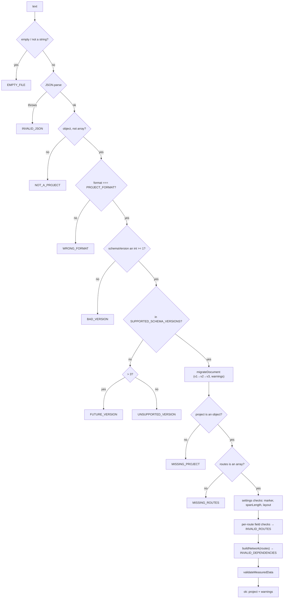
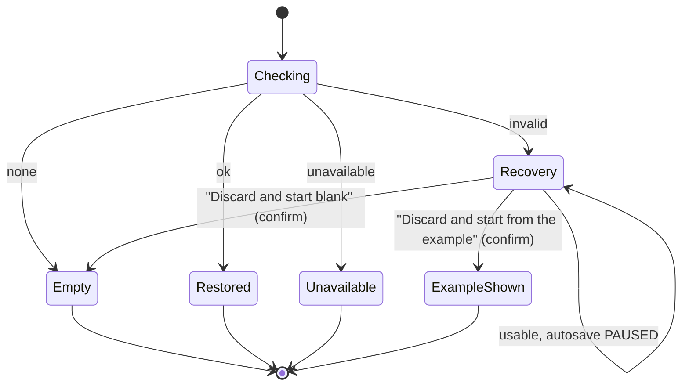

# Persistence and project format

Two mechanisms, one format:

- **Automatic persistence** — the project is written to `localStorage` after every
  authored change, so a reload or a closed tab loses nothing.
- **Explicit files** — **Save project** downloads a `.json` document, **Load project**
  reads one back.

Both use the same serialised document and the same validator, so a remembered session
and a file can never diverge in meaning.

Authoritative modules: [src/ui/project.js](../src/ui/project.js) (format, serialise,
validate, migrate, compare), [src/ui/storage.js](../src/ui/storage.js) (the
`localStorage` wrapper and its failure modes).

## Contents

1. [The document envelope](#1-the-document-envelope)
2. [Project field reference](#2-project-field-reference)
3. [What is deliberately not stored](#3-what-is-deliberately-not-stored)
4. [Schema versions and migration](#4-schema-versions-and-migration)
5. [Validation: every refusal code](#5-validation-every-refusal-code)
6. [Startup and recovery](#6-startup-and-recovery)
7. [Saving: when and how](#7-saving-when-and-how)
8. [Change detection before loading](#8-change-detection-before-loading)
9. [Determinism and stability](#9-determinism-and-stability)

---

## 1. The document envelope

```json
{
  "format": "line-route-drawing-project",
  "schemaVersion": 3,
  "metadata": { "savedAt": "2026-02-14T09:41:07.512Z" },
  "project": { … }
}
```

| Key | Value | Constant |
| --- | --- | --- |
| `format` | `"line-route-drawing-project"` | `PROJECT_FORMAT` |
| `schemaVersion` | `3` | `PROJECT_SCHEMA_VERSION` |
| `metadata.savedAt` | `new Date().toISOString()` | — |
| `project` | the payload, §2 | — |

`SUPPORTED_SCHEMA_VERSIONS = [1, 2, 3]`. Version 3 is what this build writes; 1 and 2
are still read and upgraded.

Text is written with `JSON.stringify(doc, null, 2)` — two-space indentation, so a
project file diffs and reviews cleanly.

### A real, complete example

Produced by running `serializeProjectJson()` on a one-route project with one load, one
measurement and one moved callout:

```json
{
  "format": "line-route-drawing-project",
  "schemaVersion": 3,
  "metadata": { "savedAt": "2026-02-14T09:41:07.512Z" },
  "project": {
    "routes": [
      { "id": "route-1", "from": "origin", "direction": "south", "spans": 1,
        "tc": false, "fpb": false }
    ],
    "originMarker": "plain",
    "spanLength": 40,
    "layout": "a4_landscape",
    "loads": [
      { "id": "load-1", "nodeId": "endpoint:A", "value": 12.5, "unit": "kVA" }
    ],
    "spanLengths": { "span:0,0~0,-1": 42.5 },
    "loadPlacements": {
      "endpoint:A": { "dx": 14, "dy": -22, "candidateIndex": 2 }
    },
    "spanPlacements": {},
    "nodeDesignations": { "endpoint:A": "A" },
    "exportLoads": true,
    "exportLengths": true
  }
}
```

Note the key order: `routes` first, then settings, then the measured data. That order
is fixed in `toProjectPayload()` and is part of what makes two saves comparable.

## 2. Project field reference

Every key below is written by `toProjectPayload()`. Keys marked *optional on read* may
be missing from a file; a missing key takes the stated default rather than refusing
the file.

### `project.routes[]` — the instruction list (required)

| Field | Type | On read | Notes |
| --- | --- | --- | --- |
| `id` | string, non-empty | required | `route-N`; must be unique in the file. Preserved verbatim so loads, placements and designations keyed by it survive |
| `from` | string, non-empty | required | internal id of an earlier point: `origin`, `endpoint:A`, `tc:1`, `fpb:1`, or a destination id |
| `direction` | string | required | one of the four direction keys (`north`/`south`/`east`/`west`); the validator checks membership in `VALID_DIRECTIONS` |
| `spans` | integer ≥ 1 | required | no upper limit in the format (the form's 500 cap is a UI limit only) |
| `tc` | boolean | required | must be a real boolean in the file |
| `fpb` | boolean | required | `tc && fpb` is refused |

Row order is significant: it is the order the engine replays.

### `project.originMarker` — how the Origin is drawn (required)

One of **`plain`**, **`tc`**, **`fpb`** — the keys of `MARKER_KINDS` in
[config.js](../src/config.js). **`plain` is the serialised word for the default
"ordinary X crossing"**, not `pole`; the `<option value>` in the form is `pole` and
`normalizeMarkerKind()` maps the two. The internal id `origin` and grid coordinate
`(0,0)` are the same for all three, so this never invalidates an existing reference.

### `project.spanLength` — graphical spacing (required)

Number, pixels per span, finite and `> 0`. Default `40`. The form clamps interactive
changes to 12…120; the file does not re-clamp on read. Accepts a numeric string.

### `project.layout` — page layout id (required)

One of `a3_landscape`, `a4_landscape`, `a4_portrait`, `letter_landscape`. An unknown
id is a refusal (`BAD_LAYOUT`), not a silent fallback.

### `project.loads[]` — node loads

| Field | Type | On read | Notes |
| --- | --- | --- | --- |
| `id` | string, non-empty, unique | required | `load-N` |
| `nodeId` | string, non-empty | required | a node **asset id** (`origin`, `endpoint:A`, `tc:1`, `fpb:1`, `dst:route-N`, `mid:route-N:k`) |
| `value` | number | required | `Number(value)`, finite, `> 0` (a numeric string is accepted) |
| `unit` | string | required | must normalise through `normalizeUnit()`: `kVA`, `kW`, `kVAr`, `HP` |

- `value` is written as a number, so `12.5` stays `12.5`.
- A `nodeId` the drawing no longer has is **kept and warned about**, not refused.
- A TC point is not load-eligible (`isLoadEligible('tc') === false`). A file that names a
  TC point in `loads[].nodeId` is **refused** with `INELIGIBLE_LOAD_TARGET`; see below.
  [Identity and network data](06-identity-and-data.md#5-loads).

### `project.spanLengths` — measured lengths

An **object keyed by span id**, value a number of metres:

```json
"spanLengths": { "span:0,0~0,-1": 42.5 }
```

Read by `Object.entries`, so the key is the span's asset id and the value is the
length. Each value must be finite and `> 0`. An unmeasured span simply has no key.
The table must be an object if present; anything else is `BAD_SPAN_LENGTHS`. A span id
no longer in the drawing is kept and warned about.

In memory this is a `Map`; serialisation sorts the entries by id so the file is
stable.

### `project.loadPlacements` / `project.spanPlacements` — annotation offsets

An **object keyed by asset id** whose values are:

| Field | Type | Notes |
| --- | --- | --- |
| `dx`, `dy` | finite numbers | pixel offset **from the automatic position**, rounded to 2 decimals on save — not a page coordinate |
| `candidateIndex` | integer ≥ 0, optional | which candidate slot the label was on when grabbed |

Storing an offset rather than a position is what makes an annotation follow its pole
through a re-layout and survive a reload. A placement whose asset no longer exists is
**dropped silently** (an offset means nothing without its asset) — it is not reported,
because the placement is invisible to the user anyway. A malformed *table* is
`BAD_PLACEMENTS`; a single unusable *entry* is skipped.

### `project.nodeDesignations` — issued point names

An **object keyed by id** whose values are strings:

```json
"nodeDesignations": { "endpoint:A": "A", "dst:route-2": "B" }
```

Names are trimmed, and empty/non-string entries are dropped. Serialisation sorts the
keys, so the file is stable. This table is what makes naming survive a reload: names
are authored data and are never re-derived from the drawing on load.

One physical point may legitimately carry the same name under two ids — an endpoint
that is also a route destination is stored as both `endpoint:A` and `dst:route-N` —
so the duplicate-name check compares the **coordinate** each id resolves to, not the
id itself. Two different coordinates sharing a name is `DUPLICATE_DESIGNATION`.

### `project.exportLoads` / `project.exportLengths`

Booleans. A missing key reads as **`true`** (`payload.exportLoads !== false`), which is
what an older file would have exported. Presentation only: they decide whether the
exported PDF/SVG/print carry load callouts and span lengths. They store no data and
delete nothing.

## 3. What is deliberately not stored

| Not stored | Why |
| --- | --- |
| The scene, any pixel coordinate, the SVG | A pure function of the authored fields; storing it would allow the two to disagree |
| `designationCounters` | Derived from `nodeDesignations` by `countersFromDesignations()` on load. Storing them would let a stale counter skip numbers — see the comment in `upgradeV2ToV3` |
| `nodeDesignations` for **interior** poles in a migrated v2 file | Allocated from the saved routes on first open, then stored. A migration must never invent a name the user never saw |
| The graph, edges and endpoint registry | Rebuilt by `buildNetwork` — and *validated* by it before a file is accepted |
| Validation state, error list | Recomputed |
| The viewport (zoom, pan) | Session-only; there is no view in the format |
| `state.selectedId` | UI state |
| Annotation **positions** | Only offsets (§2) |
| The render profile / drawing style | Not user-configurable |
| Route dropdown history, `#import-staging` state | Ephemeral UI |

## 4. Schema versions and migration



### What each version holds

| Version | Content | Migration |
| --- | --- | --- |
| 1 | routes, `originMarker`, `spanLength` | `upgradeV1ToV2` adds empty `loads`, `spanLengths`, `loadPlacements`, `spanPlacements` |
| 2 | + `layout` and the measured data + annotation placements | `upgradeV2ToV3` adds an empty `nodeDesignations` |
| 3 | + `nodeDesignations`, `exportLoads`, `exportLengths` | current |

Both migrations push a **warning** into the result, and the warnings are shown with
the loaded status so the upgrade is never silent:

> "This project was saved before loads and span lengths could be recorded, so it
> opens with both empty. Its drawing is unchanged."

> "This project was saved before points were named, so its poles are named for the
> first time now. The names are stored from here on and will not change."

**Migrations never invent measured data.** A version 1 project had no loads and no
lengths, so it comes back with both empty. It does not guess a length from the
drawing's spacing, because spacing is a layout choice and a length is a survey.

A **future** document is refused rather than half-read, and the message names both
versions:

> "That project was saved by a newer version of this tool (version 4, and this one
> reads up to 3). Update the tool to open it. Your current drawing has not been
> changed."

That, plus the recovery screen (§6), is what stops an older build from destroying a
newer project.

## 5. Validation: every refusal code

Validation runs top-down. The first failing *stage* refuses the file, but within a
stage every problem is collected, so a message can name all the faulty routes at once.
Nothing is returned half-applied.

| Code | Stage | Cause |
| --- | --- | --- |
| `EMPTY_FILE` | text | empty or whitespace-only |
| `INVALID_JSON` | parse | not parseable |
| `NOT_A_PROJECT` | envelope | not an object, or an array |
| `WRONG_FORMAT` | envelope | `format` is not `line-route-drawing-project` |
| `BAD_VERSION` | envelope | `schemaVersion` is not an integer ≥ 1 |
| `FUTURE_VERSION` | envelope | `> PROJECT_SCHEMA_VERSION` (3) |
| `UNSUPPORTED_VERSION` | envelope | a supported-looking version this build no longer reads |
| `MISSING_PROJECT` | payload | `project` absent or not an object |
| `MISSING_ROUTES` | payload | `routes` absent or not an array |
| `BAD_ORIGIN_MARKER` | settings | not in `VALID_ORIGIN_MARKERS` (`plain`/`tc`/`fpb`) |
| `BAD_SPAN_LENGTH` | settings | `spanLength` is not a number, not finite, or `<= 0` |
| `BAD_LAYOUT` | settings | not one of the four layout ids |
| `INVALID_ROUTES` | routes | any route is malformed: missing/duplicate id, missing `from`, unknown direction, spans not an integer ≥ 1, `tc`/`fpb` not real booleans, both markers set |
| `INVALID_DEPENDENCIES` | routes | the rows parse but `buildNetwork()` reports errors — a forward reference, an unresolvable source, a broken chain |
| `BAD_LOADS` | measured | `loads` present but not an array |
| `BAD_SPAN_LENGTHS` | measured | `spanLengths` present but not a table |
| `BAD_PLACEMENTS` | measured | a placement table present but not a table |
| `BAD_DESIGNATIONS` | measured | `nodeDesignations` present but not a table |
| `INVALID_MEASUREMENTS` | measured | any collected problem: a load with no id, a duplicate load id, no `nodeId`, a value not `> 0`, an unknown unit, a span length not `> 0` |
| `INELIGIBLE_LOAD_TARGET` | measured | a load whose resolved point cannot carry one — a live TC point. Resolved through the asset registry, so an aliased spelling is caught too. Distinct from an orphan, which is kept |

Two further codes belong to the **model operations** `addLoad()` and `reassignLoad()` — they
create or move a load — not to the file parser, and exist so that the eligibility check
cannot be skipped by omission:

| Code | Cause |
| --- | --- |
| `MISSING_NODE_RESOLVER` | called without a `lookupNode` resolver, so the point type cannot be established. A caller error; fails closed |
| `UNRESOLVED_LOAD_TARGET` | the resolver returned nothing for the id, or the id is empty, so eligibility cannot be established. Fails closed |
| `UNKNOWN_LOAD` | `reassignLoad()` only: the load id is no longer in the schedule. A stale id, not an eligibility question |

The schedule import planner rejects an ineligible row under its own `bad-value` code with
a detail naming the TC rule, because the whole-import refusal codes are about the file
text rather than about one target. It reports `missing-capability` if it is called without
both `lookupNode` and `isEligible`, because it could not verify a target at all; that is
also a caller error rather than bad user text.
| `DUPLICATE_DESIGNATION` | designations | two **different coordinates** carry the same name |

Two deliberate behaviours:

- **`INVALID_DEPENDENCIES` is a refusal.** A file whose routes do not all resolve is
  rejected whole: accepting it would replace a working drawing with a broken one and
  the user would not know which rows were at fault.
- **Unresolved references are warnings, not refusals.** A load on a missing point, or
  a length on a missing span, is kept and reported ("N loads belong to points this
  drawing no longer has. They are kept and can be reassigned."). That is the
  difference between "the file is broken" and "your drawing changed since you typed
  these numbers" — the second must never lose the numbers.

Storage has its own two outcome codes, from `saveToStorage()`:
`STORAGE_UNAVAILABLE` (no usable storage: private window, site data blocked, the
lookup itself throwing) and `STORAGE_FULL` (`QuotaExceededError`,
`NS_ERROR_DOM_QUOTA_REACHED`, code 22 or 1014). Neither throws.

## 6. Startup and recovery

`loadFromStorage()` never throws and returns exactly one of four statuses:

| Status | When | App behaviour | Reported as |
| --- | --- | --- | --- |
| `none` | no value under the key | loads the example | `empty` |
| `ok` | valid document | applies it | `restored` (+ migration warnings) |
| `invalid` | validation refused the stored text | recovery mode, autosave paused | `recovery` |
| `unavailable` | no usable storage | session stays usable, autosave off | `unavailable` |



Recovery exists because the alternative — overwriting the unreadable value — would
destroy the user's only copy of a project written by a newer build or damaged by a
failed write. While recovery is pending, the guarded `persistProject()` returns
early and the stored text is **never** touched. The escape hatch is **Save project**,
which still downloads what is on screen.

`getStorage()` is itself guarded twice: reading `globalThis.localStorage` can throw,
and a writable-looking object can throw on use, so a write probe
(`setItem`/`removeItem` of `__line_route_probe__`) decides whether storage is real.

**The storage key is versioned:**
`line-route-drawing:v3:project` (`STORAGE_KEY`). A future schema change writes beside
the old value instead of destroying it.

## 7. Saving: when and how

`persistProject()` runs after every authored change: adding, editing, deleting and
clearing routes; changing the Origin symbol, spacing or layout; adding, editing,
reassigning and removing a load; typing or clearing a span length; applying the default
length; moving an annotation; toggling either export switch; loading a project; loading
the example.

Failures are caught and surfaced as a notice. They never throw into the event handler
and never abort the user's action: the drawing keeps working with a message saying to
use **Save project**.

Serialisation is deterministic — fixed key order, numbers as numbers, ids sorted inside
the map-shaped tables — so two saves of the same project differ only in
`metadata.savedAt`.

## 8. Change detection before loading

**Load project** asks for confirmation only when the file would actually change
something. `sameAuthoredProject(a, b)` compares the authored surface field by field:

- `originMarker`, `layout`, `exportLoads`, `exportLengths` — normalised;
- `spanLength` — numerically, so `40` and `"40"` are the same value;
- `routes` — **including ids and row order**;
- `loads`, `spanLengths`, `nodeDesignations`, `loadPlacements`, `spanPlacements` —
  content.

Two logically identical projects therefore open silently. Because a project saved by
this build includes ids, names and placements, the comparison is exact: there is no
"looks the same but is not" middle ground.

## 9. Determinism and stability

Three goals, each pinned by a test:

1. **Save → load is the identity on the authored surface**
   ([test/project.test.js](../test/project.test.js),
   [test/recovery.test.js](../test/recovery.test.js)): no field silently gains or
   loses meaning.
2. **Ids are stable.** Route ids, load ids and asset ids survive a round trip, so
   loads, lengths, names and annotation offsets still point at the same things.
3. **Names are stable.** `nodeDesignations` round-trips verbatim, and
   `designationCounters` is re-derived from it, so the same pole carries the same name
   after a reload and a deleted name is never reissued
   ([test/designations.test.js](../test/designations.test.js),
   [test/route_identity.test.js](../test/route_identity.test.js)).
