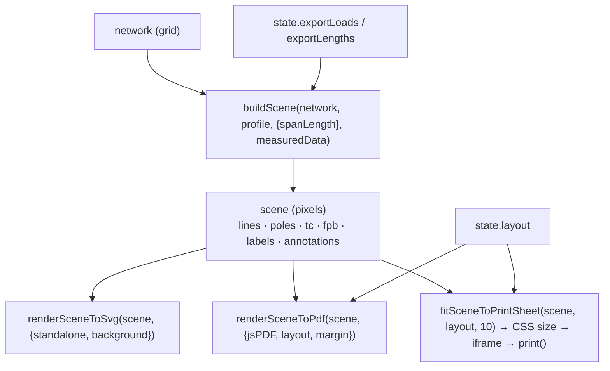
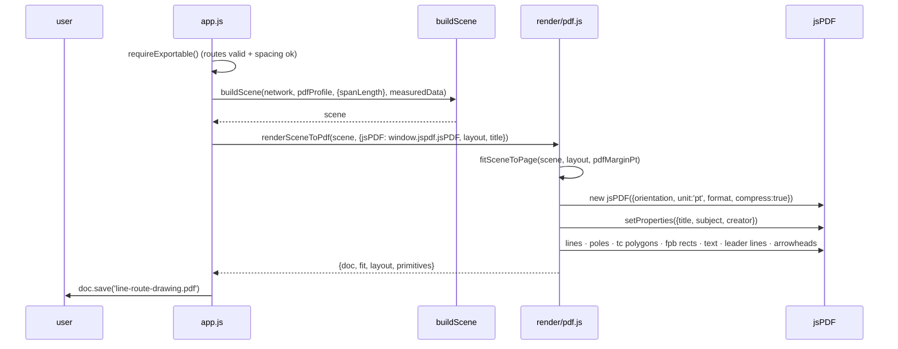
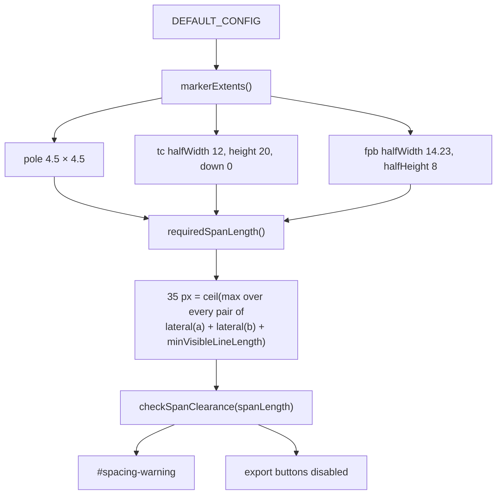

# Rendering and export

One scene, three outputs. This document covers the scene-to-output pipeline, the
exact `PAGE_LAYOUTS` table, the fit-to-sheet arithmetic, the export switches, and the
regression history that made the fit rule mandatory.

Authoritative modules: [src/render/svg.js](../src/render/svg.js),
[src/render/pdf.js](../src/render/pdf.js), [src/render/print.js](../src/render/print.js),
[src/config.js](../src/config.js).

## Contents

1. [The pipeline and what each renderer may and may not do](#1-the-pipeline-and-what-each-renderer-may-and-may-not-do)
2. [Render profiles](#2-render-profiles)
3. [The four page layouts](#3-the-four-page-layouts)
4. [PDF export](#4-pdf-export)
5. [SVG export](#5-svg-export)
6. [Regression history](#6-regression-history)
7. [Span spacing and clearance](#7-span-spacing-and-clearance)
8. [Draw order and z-order](#8-draw-order-and-z-order)
9. [Annotation rendering](#9-annotation-rendering)
10. [What each output contains](#10-what-each-output-contains)

---

## 1. The pipeline and what each renderer may and may not do



Every export **rebuilds the scene** with its own profile. The preview scene is never
reused, which is what makes the per-format label rules and the two export switches
exact.

| Renderer | Computes geometry? | Fit |
| --- | --- | --- |
| `svg.js` | **No.** Emits primitives from the scene verbatim | none — the scene is already the drawing |
| `pdf.js` | **No.** Only the uniform aspect-preserving page transform | `fitSceneToPage()`, points |
| `print.js` | **No.** Only the uniform aspect-preserving sheet size | `fitSceneToPrintSheet()`, millimetres |
| Browser preview | No — it inserts the SVG from `svg.js` | viewport zoom/pan (not part of the drawing) |

The only shared geometry between renderers is `poleCrossPath()` and
`tcTrianglePoints()` from `render/svg.js`, which `render/pdf.js` imports so the X and
the triangle have a single definition. The dependency never runs the other way.

## 2. Render profiles

Four profiles in `RENDER_PROFILES`. Every one draws lines, poles, TC markers, FPB
markers and annotations; they differ in **text** and the **completeness notice**:

| Flag | `preview` | `pdf` | `svg` | `print` |
| --- | --- | --- | --- | --- |
| `showLines` | ✅ | ✅ | ✅ | ✅ |
| `showPoleMarkers` | ✅ | ✅ | ✅ | ✅ |
| `showTcMarkers` | ✅ | ✅ | ✅ | ✅ |
| `showFpbMarkers` | ✅ | ✅ | ✅ | ✅ |
| `showAnnotations` | ✅ | ✅ | ✅ | ✅ |
| `showOriginLabel` | ✅ | ❌ | ❌ | ❌ |
| `showAlphaLabels` | ✅ | ❌ | ❌ | ❌ |
| `showCompleteNotice` | ✅ | ❌ | ❌ | ❌ |
| `showJunctionMarkers` | ❌ | ❌ | ❌ | ❌ |
| `showNodeLoads` | ✅ | ✅ | ✅ | ✅ |
| `showSpanLengths` | ✅ | ✅ | ✅ | ✅ |

Rules that follow:

- **Exports hide the drawing's own text** — the `Origin` word and the alphabetical
  letters `A`, `B`, … — because those identify the *drawing session*, not the
  installation. Everything that is a fact about the installation stays: the `FPB` text
  inside its box, the load callouts and the span lengths.
- **The measurement-completeness notice is never exported.** It is an application
  status message, not part of a technical drawing.
- **`showJunctionMarkers` is `false` everywhere.** Junctions exist in the model and are
  used for annotations and hit targets, but no profile draws a junction symbol; a
  crossing is simply a pole.
- The two switches (`showNodeLoads`, `showSpanLengths`) are `true` in the profiles and
  are then **overridden per export** by wrapping the profile:
  `{...profile, showNodeLoads: state.exportLoads}`. The override is applied once, in
  the annotation layer, so both `svg.js` and `pdf.js` automatically agree.
- `showNodeLoads`/`showSpanLengths` are `true` for `preview` **unconditionally**, so
  the working view always shows everything the user entered, whatever the switches
  say.

The profile is resolved by `resolveProfile()`, which accepts either an id or an object
— that is how the per-export override is passed in without mutating a frozen profile.

## 3. The four page layouts

`PAGE_LAYOUTS` is a frozen object of four frozen layouts. This is the **complete,
exact** table; the numbers are `widthPt`/`heightPt` in PDF points (1 pt = 1/72 in,
`MM_PER_POINT = 25.4/72 = 0.352778`).

| id | label | format | orientation | `widthPt` | `heightPt` | `cssPageSize` | paper |
| --- | --- | --- | --- | --- | --- | --- | --- |
| `a4_landscape` | A4 landscape | `a4` | `landscape` | 841.89 | 595.28 | `A4 landscape` | 297 × 210 mm |
| `a4_portrait` | A4 portrait | `a4` | `portrait` | 595.28 | 841.89 | `A4 portrait` | 210 × 297 mm |
| `a3_landscape` | A3 landscape | `a3` | `landscape` | 1190.55 | 841.89 | `A3 landscape` | 420 × 297 mm |
| `letter_landscape` | Letter landscape | `letter` | `landscape` | 792 | 612 | `Letter landscape` | 279.4 × 215.9 mm |

Default: `a4_landscape`.

Notes:

- **`cssPageSize` is the only bridge between a layout id and CSS.** The mapping is
  `cssFormatName(format)` → `{a3:'A3', a4:'A4', letter:'Letter'}` composed with
  `cssOrientationName(orientation)` → `landscape|portrait`. Both **throw `RangeError`**
  for an unknown value. That is deliberate: an earlier fallback silently printed A4
  when the format was not recognised, so a wrong sheet size could not be detected. It
  is now a configuration fault that fails loudly.
- **There are only four layouts.** There is no custom size, no A5, no A2, no full-bleed
  option. See [Known limitations](10-limitations.md).
- The layout controls both the PDF page and the print `@page` size, so the sheet the
  browser prints is the sheet the user chose.

### Fit-to-sheet arithmetic

Both exporters apply the same rule: **one uniform scale, taken from whichever
constraint binds, drawing centred in the printable box.**

**PDF** (`fitSceneToPage`, points, default margin `pdfMarginPt = 28`):

```js
boxWidth  = layout.widthPt  − margin·2
boxHeight = layout.heightPt − margin·2
scale     = Math.min(boxWidth / scene.width, boxHeight / scene.height)
drawWidth  = scene.width  · scale
drawHeight = scene.height · scale
offsetX    = margin + (boxWidth  − drawWidth ) / 2
offsetY    = margin + (boxHeight − drawHeight) / 2
```

**Print** (`fitSceneToPrintSheet`, millimetres, `MARGIN_MM = 10`):

```js
boxWidthMm  = layout.widthPt  · MM_PER_POINT − 10·2
boxHeightMm = layout.heightPt · MM_PER_POINT − 10·2
scale       = Math.min(boxWidthMm / scene.width, boxHeightMm / scene.height)
widthMm     = scene.width  · scale
heightMm    = scene.height · scale
```

Both `throw RangeError` when the margin leaves no positive box, when the scene has no
positive extent, or when the layout has no positive size. Neither ever returns a
negative or NaN size.

### Verified numbers for the bundled example

Scene **536 × 736 px** (print/pdf/svg profile at spacing 40). Computed by running
`fitSceneToPrintSheet` for each layout at a 10 mm margin:

| layout | printable box | scale | drawing on paper | which axis binds |
| --- | --- | --- | --- | --- |
| `a4_landscape` | 277.0 × 190.0 mm | 0.2582 | 138.4 × 190.0 mm | **height** |
| `a4_portrait` | 190.0 × 277.0 mm | 0.3545 | 190.0 × 260.9 mm | **width** |
| `a3_landscape` | 400.0 × 277.0 mm | 0.3764 | 201.7 × 277.0 mm | **height** |
| `letter_landscape` | 259.4 × 195.9 mm | 0.2662 | 142.7 × 195.9 mm | **height** |

Three of the four landscape layouts are constrained by the *height* of the sheet,
because the example drawing is taller than it is wide. That single fact is the root
cause of the `c39eca9` regression (§6): any fit rule that consults only the width is
wrong for this drawing on every landscape sheet.

## 4. PDF export

`#btn-pdf` → file `line-route-drawing.pdf`, status line names the paper used.



Contract:

- **Vector only.** No rasterisation, everything is a stroke, path or text run, so it
  scales and stays selectable.
- `renderSceneToPdf()` throws `TypeError` if `jsPDF` is not a function, and
  `RangeError` for an unknown layout id. It is a pure function of `(scene, options)`
  apart from the jsPDF construction.
- Every primitive goes through one transform: `tx(x) = offsetX + x·scale`,
  `ty(y) = offsetY + y·scale`. There is no second scaling path, which is what prevents
  the "markers drawn at the wrong scale" class of defect.
- The triangle is emitted as a polygon through the same three points
  `tcTrianglePoints()` produces for the SVG.
- jsPDF 4.2.1 is vendored at `vendor/jspdf/jspdf.umd.cjs` and loaded by a classic
  `<script>` before the application module, exposing `window.jspdf.jsPDF`. There is no
  network request and no bundler.
- `compress: false` is a testing option so tests can assert on raw operators.

### PDF page scales for the bundled example

The PDF fit uses **points** and the default `pdfMarginPt = 28`, so its scale differs
from the print scale in millimetres above. Both were verified by running the code
with the example scene (536 × 736 px):

| layout | PDF `fit.scale` | print `scale` (mm path, §3) |
| --- | --- | --- |
| `a4_landscape` | 0.7327 | 0.2582 |
| `a4_portrait` | 1.0061 | 0.3545 |
| `a3_landscape` | 1.0678 | 0.3764 |
| `letter_landscape` | 0.7554 | 0.2662 |

The two columns are not comparable numbers: the PDF scale maps scene pixels to
**points** with a 28 pt margin, the print scale maps them to **millimetres** with a
10 mm margin. They are listed together because an earlier defect (commit `e48b67c`)
was a marker drawn at raw scene size instead of through `fit.scale` — the triangle
came out about 2.4× too large at the A4-landscape scale of 0.7327. Any suspicion that
a symbol is drawn at the wrong size should be checked against the PDF column, and
`test/pdf_layouts.test.js` now asserts it on every layout rather than only on A4
landscape.

## 5. SVG export

`#btn-svg` → file `line-route-drawing.svg`, with an opaque white background (so it
places cleanly on a slide) and `standalone: true` (the full `<svg>` document).

- Editable primitives: `<line>`, `<path>`, `<polygon>`, `<rect>`, `<text>` — no image,
  no `<foreignObject>`, no embedded font. Opening it in Illustrator, Inkscape or Word
  gives real objects.
- `escapeXml()` is applied to every text node and every attribute value, so a value the
  user typed cannot break the document.
- The same scene, so the SVG and the PDF are the same drawing at different scales.
- The preview uses the same renderer with `standalone: false` and the `preview`
  profile, which is why the on-screen drawing and the downloaded SVG differ only in
  labels and the notice.

## 6. Regression history

These are the fixes whose rules are now load-bearing. They are recorded because the
guarantees above only make sense as corrections of specific failures.

### 6.1 `c39eca9` — the print fit ignored the sheet height

**Symptom.** Printing produced **two pages** on A4 landscape, A3 landscape and Letter
landscape. A4 portrait printed on one page. This looked intermittent because it
depended on the chosen layout.

**Root cause.** The print stylesheet sized the embedded SVG with

```css
svg { width: 100%; height: auto; }
```

`width: 100%` scales the drawing to the *content width* and never consults the sheet
*height*. The example drawing is 536 units wide by 736 tall — taller than it is wide.
On a landscape sheet, filling the width makes it taller than the printable area. The
commit recorded these measured figures, and they reproduce exactly from the current
constants (536 × 736 scene, 10 mm margin):

| layout | printable box | height the width-driven rule produced | factor | pages before the fix |
| --- | --- | --- | --- | --- |
| `a4_landscape` | 277.0 × 190.0 mm | 380.4 mm | **2.00×** | 2 |
| `a3_landscape` | 400.0 × 277.0 mm | 549.3 mm | **1.98×** | 2 |
| `letter_landscape` | 259.4 × 195.9 mm | 356.2 mm | **1.82×** | 2 |
| `a4_portrait` | 190.0 × 277.0 mm | 260.9 mm | 0.94× | **1** |

A4 portrait was the only layout that fitted, and only because its printable area is
taller than it is wide. That is why the fault looked layout-specific rather than
universal: the one configuration anybody happened to check first was the one that
worked. The paper itself was already correct throughout — `cssPageSize` produced a
Letter-landscape `@page` rule and Chrome's MediaBox came back 792 × 612 pt — so the
defect was purely the size given to the SVG *inside* that page.

**Fix.** `fitSceneToPrintSheet()` computes an **explicit** width and height in
millimetres with one uniform scale taken from the binding constraint:

```css
svg { display:block; width:138.401mm; height:190.000mm; margin:0 auto }
svg, body { page-break-inside:avoid; break-inside:avoid }
```

plus `@page{size:<layout.cssPageSize>; margin:10mm}` and `html,body{margin:0;padding:0}`
(repeating the zero margins stops the body's own margin pushing the drawing over the
edge).

**Guarantees now in force, each tested:**

- One page, for all four layouts — automated, per layout, in
  `scripts/test-browser.mjs`.
- The drawing never exceeds the printable box, and keeps its aspect ratio.
- The printed paper is the chosen layout, not a hardcoded A4.
- Nothing splits across sheets: `page-break-inside: avoid` **and**
  `break-inside: avoid` (both spellings, because browsers disagree).
- The margin constant is used in exactly one place per export path and appears in both
  the `@page` rule and the SVG size, so the two cannot drift.
- Letter landscape additionally passed **manual validation in the Chrome print
  dialog**; physical-printer validation of the sheets was carried out by the user.

### 6.2 `dca41d5` — TC triangle eaten the leaving span

**Symptom.** The span leaving a TC looked shorter than the pole spacing.

**Root cause.** The triangle was centred on the node, so half of it occupied the
outgoing span.

**Fix.** The triangle is anchored on its **downstream base midpoint**, which is the
node, and extends backwards over the cable that arrives. The leaving span is therefore
a full configured span, and both cables still meet the symbol
([Route and geometry §8](04-route-and-geometry.md#8-tc-triangle-geometry)).
Pinned by `test/tc_anchor.test.js` and by the browser check *"the printed leaving span
equals the configured spacing"* on every layout.

### 6.3 Earlier fixes still expressed in the code

| Fix | Rule now enforced |
| --- | --- |
| Print stylesheet hardcoded A4 | `layout.cssPageSize` always comes from `PAGE_LAYOUTS`; the CSS name mapping throws instead of falling back |
| PDF drew markers at the wrong scale | One `tx`/`ty` transform for every primitive; the triangle reuses the SVG's point definition |
| Letters and the origin word appeared on exported sheets | `showOriginLabel` / `showAlphaLabels` are `false` in all three export profiles |
| The completeness notice appeared on exported sheets | `showCompleteNotice` is `false` in all three export profiles |
| A designations table was lost on reload, renaming every pole | `nodeDesignations` is validated **and returned** into the project the caller applies; the table rides with the measured sections |

## 7. Span spacing and clearance

Spacing (`#field-spacing`) is a **layout choice**: it changes every span's length at
once and never changes the topology.

| Value | Where |
| --- | --- |
| default | `DEFAULT_CONFIG.spanLength = 40` px |
| UI clamp | `MIN_SPACING = 12` … `MAX_SPACING = 120` |
| minimum workable | `requiredSpanLength()` = **35** px (shipped config) |
| symbols-touching limit | `requiredClearanceDistance()` = **33** px |

The requirement is **derived**, never hardcoded: `clearance.js` measures the same
marker primitives the renderers consume.



The FPB box is what sets the floor: it is **not** scaled with spacing (shrinking it
would clip its own label), so its 14.23 px half-width plus a pole's 4.5 px plus the
6 px `minVisibleLineLength` gives 24.73; the FPB–FPB pair gives
14.23 + 14.23 + 6 = 34.46, which rounds up to **35**.

The TC triangle is *not* a floor because the scene shrinks it to fit
(`tcMaxSpanFraction = 0.75`, and further when a marker sits immediately upstream), so
demanding its full 20 px height would reject spacing the scene draws perfectly well.
The overlap-only limit is kept separate as `requiredClearanceDistance()` so a caller
can distinguish "the symbols collide" from "the line is too short to see".

Below the requirement:

- `#spacing-warning` appears, naming the required value in plain language ("A spacing
  of 20 px is too tight. The point symbols would overlap and the route lines between
  them would disappear. Set the spacing to 35 px or more.");
- the three export buttons are disabled;
- the drawing stays visible and **the typed value is kept** — nothing is silently
  corrected.

## 8. Draw order and z-order

Identical in all three outputs:

```
lines → poles (X) → TC triangles → FPB boxes → labels (origin, letters)
      → span-length labels → load callouts (+ leaders, arrowheads) → completeness notice
```

Consequences: a marker is never hidden by a cable; a callout is never hidden by a
cable; the notice sits on top. The preview additionally draws **hit areas** last, but
they are transparent and exist only to catch clicks.

## 9. Annotation rendering

- A **load callout** is a box of one line per load record on that pole, plus a leader
  line and an arrowhead pointing at the pole. Never summed, never converted.
- A **span length label** sits near the middle of the span, rotated to read
  horizontally (no text along the cable), and shows `— m` when unmeasured.
- Both are placed from **candidate positions** scored against obstacles
  (`collide.js`), then offset by any stored user drag. The stored offset is a delta,
  so the annotation follows its pole through a re-layout.
- **The stored offset is in scene units, not screen pixels.** Dragging divides the
  pointer's travel by `view.zoom` before adding it to the offset
  (`scene delta = screen delta / zoom`), because the preview's only transform is the CSS
  `translate() scale()` that `applyView()` writes - the SVG's `width`/`height` match its
  `viewBox`, so there is no second scale. A stored offset is therefore **independent of
  zoom and of pan**: re-zooming or panning re-renders the same scene geometry and cannot
  move a label that the user placed. This is verified at three zoom levels in browser
  `§Manual annotation placement`, and the arithmetic is finding
  [F3](findings.md#f3-drag-at-zoom-is-verified-against-the-stored-scene-offset).
- The notice overlay described in §8 is drawn above the callouts, and it stays above
  them, so it still paints over any label that reaches the same band. It is however
  **presentational only**: the group carries `pointer-events="none"`, so a press on it
  passes straight through to whatever is underneath — an annotation keeps its drag, and
  an empty part of the band behaves like the bare stage. Visible but not interactive is
  the whole contract; before it, a label under the band could not be dragged at all and
  the gesture panned the drawing instead
  ([F12](findings.md#f12-the-in-drawing-notice-overlay-intercepted-pointer-events-over-the-annotations-beneath-it))
- A press is never captured by an informational overlay, and the notice is the only such
  overlay in the preview. The separate `#hit-areas` layer *is* interactive on purpose —
  it is what makes a pole or a span clickable — so pressing a pole topmost selects it, and
  a label dragged directly on top of one pans instead of moving, exactly as pressing the
  bare pole does.
- Both are emitted as `<g id="callout:…">` / span-label groups in SVG and as a line +
  polygon + text run in PDF, from the same scene record.
- The annotation layout is computed in an unpadded frame and shifted by the scene
  padding, and `labelSlots` is built even when the profile hides the letters — so the
  same project places the same callout in the preview and on the sheet.

## 10. What each output contains

| Content | Preview | PDF | SVG | Print |
| --- | --- | --- | --- | --- |
| Route lines | ✅ | ✅ | ✅ | ✅ |
| Pole X symbols | ✅ | ✅ | ✅ | ✅ |
| TC triangles | ✅ | ✅ | ✅ | ✅ |
| FPB boxes with `FPB` text | ✅ | ✅ | ✅ | ✅ |
| `Origin` word | ✅ | — | — | — |
| Point letters `A`, `B`, … | ✅ | — | — | — |
| Span length labels | ✅ | switch | switch | switch |
| Load callouts | ✅ | switch | switch | switch |
| Completeness notice | ✅ | — | — | — |
| Drawing reference panel | ✅ | — | — | — |
| Selection rings/bands | ✅ | — | — | — |
| White background | app CSS | ✅ (page) | ✅ | ✅ (sheet) |
| One sheet | n/a | ✅ | n/a | ✅ |

**Export gating.** All three buttons are disabled while any route is invalid
(`isExportable()`) or while the spacing is below `requiredSpanLength()`. Their tooltip
states the cause: "Fix the route errors before exporting."
