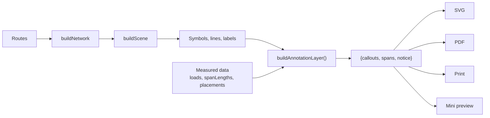

# Annotation placement: how a label's position is decided, and how it got fast

This document covers the part of the drawing that is *chosen* rather than computed: where a
load callout and a span-length label are drawn, what "does this clash" means, and the spatial
index added under finding [F13](findings.md#f13-annotation-placement-is-quadratic-in-the-number-of-labels)
to make that choice affordable on a 501-span drawing.

It is deliberately separate from [Route and geometry](04-route-and-geometry.md), which covers
what is drawn, and from [Rendering and export](07-rendering-and-export.md), which covers how a
record becomes ink.

## Contents

1. [What the placement pass decides](#1-what-the-placement-pass-decides)
2. [Where it sits in the pipeline](#2-where-it-sits-in-the-pipeline)
3. [The clash rule, exactly](#3-the-clash-rule-exactly)
4. [The cost problem: an exhaustive scan](#4-the-cost-problem-an-exhaustive-scan)
5. [The broad-phase index](#5-the-broad-phase-index)
6. [Why a uniform grid, and why per scene](#6-why-a-uniform-grid-and-why-per-scene)
7. [Choosing the cell size by measurement](#7-choosing-the-cell-size-by-measurement)
8. [The equivalence evidence](#8-the-equivalence-evidence)
9. [Results before and after](#9-results-before-and-after)
10. [What was deliberately not optimized](#10-what-was-deliberately-not-optimized)
11. [Changing this area safely](#11-changing-this-area-safely)

---

## 1. What the placement pass decides

`buildAnnotationLayer()` in [src/geometry/annotation_layer.js](../src/geometry/annotation_layer.js)
produces two lists:

| Record | Id form | What it carries |
| --- | --- | --- |
| Callout | `callout:<canonicalNodeId>` | The load text for one node, its centre, the side it sits on, `candidateIndex`, `collisions`, `manual`, and the leader + arrowhead derived from the centre |
| Span label | `span:<spanId>` | `"<length> m"` (or `"— m"` when unmeasured), the same placement fields, plus `a`, `b` and `measured` |

Every record is decided the same way, per [src/geometry/annotations.js](../src/geometry/annotations.js):

1. **Size** comes from the text (`measureBlock`) — the layout reserves the real glyph box, not
   a guess.
2. **Candidates** are generated in a fixed preference order: for a callout, directions around
   its node with East and West before North and South, right before left; for a span label,
   positions beside the span midpoint. The order *is* the priority.
3. **The first candidate with zero collisions wins.** If every candidate collides, the one with
   the fewest collisions is kept — an annotation in an awkward place is readable; one that
   vanished is a number nobody can check.
4. **A manual offset wins over all of it.** The user's drag is stored as a nudge (`dx`, `dy`)
   from the candidate that was actually shown (`candidateIndex`), so it survives a reload and a
   later edit cannot strand it.

The pass order is fixed: **callouts first**, then span labels, each taking the boxes the
others have already claimed. Callouts come first because they are the denser, more constrained
objects; giving them first choice keeps them attached to their poles.

Determinism is a correctness property here, not a nicety: a re-export has to produce the same
sheet, and a saved manual placement has to still point at the same place. There is no
randomness anywhere in this path, and nothing depends on iteration order that is not itself
defined.

## 2. Where it sits in the pipeline



The layer sees the scene *after* every symbol, line and printed label is final, so it can
avoid all of them. Its obstacle set is assembled from the same primitives the renderers draw:

| Source | Box | Count on the 501-span drawing |
| --- | --- | --- |
| `lines` | Each final (clipped) line primitive, ±1 px for the stroke | 501 |
| `poles` | `poleMarkerSize / 2 + 1` around the crossing | 502 (minus TC/FPB anchors) |
| `tc`, `fpb` | The marker's own box from `halfWidth`/`height` | per marker |
| `labelSlots` | The reserved box of each printed designation, from `measureBlock` | per label |

Plus a growing list — `taken` — of the boxes already claimed by placed annotations. The
notice is placed last, so it cannot displace a label.

## 3. The clash rule, exactly

A candidate box is `{x1, y1, x2, y2}` from `boxAround(centre, size)`. A clash is
`annotateCollides(candidate, obstacle, clearance)`, which is `boxesOverlap` with the margin:

```js
!(a.x2 + margin <= b.x1 || b.x2 + margin <= a.x1 ||
  a.y2 + margin <= b.y1 || b.y2 + margin <= a.y1)
```

`clearance` is `config.annotClearance` (**3 px**). The details that matter, each pinned by
`test/collision_semantics.test.js`:

- **Edges that merely touch do not clash** at zero margin, because the comparison is `<=`.
  A gap of exactly the clearance is legal; one thousandth less is not.
- **A clash is counted per entry, not per area.** The same obstacle registered twice counts
  twice. A `{box}` wrapper and a bare box are the same shape.
- **A zero-height box overlaps nothing at zero clearance**, since its top and bottom edges are
  the same line. With any real clearance it behaves like any other box.
- **Leaving the frame is one extra collision.** The frame is not an obstacle and is not in the
  index; it is the sheet edge, and a candidate that would be clipped has to lose to one that
  fits.
- **Negative coordinates are ordinary coordinates.** The layout works in an unpadded frame and
  shifts into the scene afterwards, so the frame origin is `0, 0` for layout purposes.

The layout compares **counts**, not identities: the winner is the candidate with the fewest
clashes, and the first one in candidate order wins a tie. That is the one property that makes
a spatial index safe here — see [§6](#6-why-a-uniform-grid-and-why-per-scene).

## 4. The cost problem: an exhaustive scan

Before F13, `countCollisions()` walked every static obstacle and every already-placed label for
every candidate of every annotation:

```js
for (const obstacle of obstacles) if (annotateCollides(box, obstacle.box ?? obstacle, c)) count += 1;
for (const other of taken)       if (annotateCollides(box, other, c))                 count += 1;
```

With *n* annotations, ~1044 obstacles and up to six candidates per span label, that is
`n x candidates x (obstacles + taken)` — quadratic in *n*. Measured
([§9](#9-results-before-and-after)): 1.0 ms at 50 spans, 75.7 ms at 800, growing 2.0–2.3x per
doubling at the small end and 3.3x at the large end. On the 501-span drawing it *was* the scene
build.

## 5. The broad-phase index

[src/geometry/spatial_index.js](../src/geometry/spatial_index.js) is a DOM-free, policy-free
uniform grid. It answers one question: **how many registered boxes clash with this one?**

```js
const index = createObstacleIndex({ clearance: config.annotClearance });
for (const obstacle of obstacles) index.insert(obstacle.box ?? obstacle);
// ... per annotation:
const collisions = index.countCollisions(boxAround(centre, size));
// ... once the annotation is accepted:
index.insert(claimedBox);
```

| Step | What happens |
| --- | --- |
| **Construction** | Once per scene, in `buildAnnotationLayer()`, seeded with the static obstacles in the order they were collected |
| **Insert** | The box is grown by the clearance and registered in every cell that grown box touches; the entry keeps its insertion index as its identity |
| **Query** | The candidate box is grown by the clearance, and only the cells it touches are visited |
| **Dedup** | A per-query stamp marks an entry once, so a box spread over many cells still counts once |
| **Narrow phase** | Every proposed entry is put through `annotateCollides`, unchanged. The grid proposes; the exact rule decides |
| **Update** | An accepted annotation is inserted at the moment its box is pushed to `taken` — no earlier, no later. Rejected candidates are never inserted |
| **Lifetime** | The index is a local object inside one `buildAnnotationLayer()` call. No module-level state, nothing carried between drawings or reloads |

`collisionCounter()` is the single place the layout asks the question: it adds the frame
penalty to the index count. `placeCallout()` and `placeSpanLabel()` accept a `index` and fall
back to building one from the lists they were given, so there is **one** implementation of the
counting rule in production — the exhaustive loop is gone from `src/`.

**Why it cannot lose an obstacle.** If `annotateCollides(a, b, c)` is true, then the grown
boxes overlap in both axes with strict inequality, so their cell ranges — computed with the
same `Math.floor` on the same continuous coordinates — share at least one cell. The query
therefore visits the entry. Boxes far larger than a cell are registered in every cell they
touch, and boxes at negative coordinates use the same floor, which is what makes negative cell
indices work without a special case.

**Why iteration order cannot change a decision.** The result is a count. Entries are visited in
insertion order within a cell and each contributes at most 1, so no sort, no `Set` ordering and
no tie-break depends on the grid. The layout's own tie-break is the candidate index, which the
index never touches.

## 6. Why a uniform grid, and why per scene

The alternative shapes were considered and rejected for stated reasons:

| Option | Why not |
| --- | --- |
| A tree (R-tree, k-d) | The drawings are extremely tall and narrow (72 x 20112 px for 501 spans). One column of cells already cuts the candidate set by row count; a tree adds insertion cost and balancing, and balanced-tree history is a source of order-dependence |
| An interval index on one axis | Spans are vertical *and* horizontal; an axis choice that suits one drawing is wrong for the next |
| A global, module-level index | Two drawings, a reload, or a switch of project would have to be invalidated correctly. One index per pass cannot be wrong |
| Rebuilding per candidate | That is strictly worse than the exhaustive scan it replaces |
| Indexing only static obstacles | The growing `taken` list is the other half of the cost, and it is exactly the half that made the algorithm quadratic in *n* |

Per scene, not per annotation: within one pass the obstacle set changes only by *addition*, so
one index serves all 551 annotations on the surveyed drawing and is built once for the 1044
obstacles.

## 7. Choosing the cell size by measurement

`DEFAULT_CELL_SIZE = 128`. It was measured, not assumed: with everything else identical, the
constant was changed and `npm run benchmark` was run three times per value, taking the median
of the medians for the `place annotations` phase.

| Cell size (px) | A-example | B-medium | C-large | D-surveyed |
| ---: | ---: | ---: | ---: | ---: |
| 24 | 0.31 | 0.71 | 4.91 | 4.79 |
| 32 | 0.24 | 0.66 | 4.88 | 4.45 |
| 48 | 0.25 | 0.82 | 3.71 | 4.02 |
| 64 | 0.22 | 0.70 | 3.95 | 3.91 |
| 96 | 0.22 | 0.69 | 3.77 | 3.77 |
| **128** | **0.20** | **0.58** | **3.69** | 4.04 |
| 160 | 0.21 | 0.68 | 3.89 | 4.45 |
| 192 | 0.21 | 0.59 | 4.10 | 3.79 |
| 256 | 0.22 | 0.63 | 4.11 | 4.16 |
| 384 | 0.24 | 0.76 | 3.96 | 4.10 |

The curve is flat from 48 px to 256 px: the remaining cost is per-candidate bookkeeping, not
lookup. 128 px was chosen as the middle of that flat region, and the choice is not
load-bearing — `test/spatial_index.test.js` asserts that counts do not change with the cell
size. Values below ~32 px spend more time on cell bookkeeping than they save.

## 8. The equivalence evidence

The acceptance contract was fixed **before** the change and is described in
[Testing §6](08-testing.md#6-annotation-placement-the-exact-output-contract): for all four
baseline drawings, every automatic placement keeps its identity, candidate, centre, collision
count and manual flag, byte for byte.

| Evidence | Where | What it would catch |
| --- | --- | --- |
| Committed captures of every placement in all four drawings, recorded from the unoptimized code | `test/fixtures/placement/*.txt` (`placement_characterization.test.js`) | Any change in any placement decision, including leader and arrowhead |
| Digest per drawing for the three export profiles | `test/fixtures/placement/export-digests.json` | Drift in the export path, which uses a different page frame |
| The pre-optimization scan, kept as a test-only oracle | `test/support/exhaustive_collisions.mjs` | A wrong collision count at any candidate |
| Replay of every captured count through the oracle | `placement_characterization.test.js` | The oracle itself drifting from production geometry |
| Grid vs oracle on the real obstacle sets: every placed position plus 300 generated boxes per drawing | `test/spatial_index.test.js` | A false negative anywhere in the real geometry |
| Adversarial geometry: multi-cell boxes, boundaries, negatives, degenerates, duplicates, unaligned sweep | `test/spatial_index.test.js` | Off-by-one cell ranges, deduplicated entries, lost stamps |
| Cell-size invariance | `test/spatial_index.test.js` | A tuning constant leaking into placement |

**Mutation evidence.** Two deliberately incorrect broad phases were applied and reverted:

| Mutation | Result |
| --- | --- |
| Query cell range shrunk by one cell (`maxX -= 1`, `maxY -= 1`) | Both equivalence tests fail for **all four** drawings (preview and all three export profiles), plus ten of the index tests — labels moved, and the fixtures named the records |
| Duplicate obstacles deduplicated by identity on insert | `a duplicated obstacle still counts twice` fails |

Both were restored byte-for-byte (`cmp` clean) and the suites re-run green.

## 9. Results before and after

Same machine, same scripts, sequential runs, medians. Environment: 13th Gen Intel Core
i5-13500T (20 threads), 7.7 GB, Windows 10.0.26200, Node v24.4.1, Chrome 157 headless.

**Node, the four baseline drawings** (median of 25 iterations per phase, median of three runs;
before = `cb4d39d`, after = this change):

| Phase | A-example | B-medium | C-large | D-surveyed |
| --- | --- | --- | --- | --- |
| build network | 0.03 → 0.03 | 0.07 → 0.05 | 0.23 → 0.30 | 0.26 → 0.27 |
| **place annotations** | **0.20 → 0.20** | **0.80 → 0.62** | **13.05 → 4.07 (3.2x)** | **13.00 → 4.20 (3.1x)** |
| build scene | 0.41 → 0.42 | 0.96 → 0.66 | 14.24 → 5.23 (2.7x) | 13.14 → 5.42 (2.4x) |
| render main svg | 0.12 → 0.16 | 0.30 → 0.26 | 1.61 → 1.46 | 1.68 → 1.63 |
| render mini svg | 0.13 → 0.16 | 0.28 → 0.33 | 2.04 → 1.88 | 1.93 → 1.96 |
| full pipeline | 0.65 → 0.70 | 1.61 → 1.85 | **17.20 → 8.94 (1.9x)** | **18.53 → 10.31 (1.8x)** |

All values in ms. The two small drawings are unchanged within noise: the index costs one
insert per obstacle and one query per candidate, which is not measurable at 34–96 spans. The
`build network` differences are noise in a phase the change does not touch.

**Scaling series** (`npm run benchmark -- --scaling`, five runs each, median):

| Spans | Before | After | Speed-up | After, per span |
| ---: | ---: | ---: | ---: | ---: |
| 50 | 1.02 ms | 0.66 ms | 1.5x | 13.2 µs |
| 100 | 1.99 ms | 1.32 ms | 1.5x | 13.2 µs |
| 200 | 5.60 ms | 2.75 ms | 2.0x | 13.8 µs |
| 400 | 20.61 ms | 8.84 ms | 2.3x | 22.1 µs |
| 800 | 75.66 ms | 22.60 ms | 3.3x | 28.3 µs |

The growth per doubling falls from 2.0–2.3x (small) and 3.3x (large) to 1.6–2.0x in the middle
of the series, and the cost per span now only rises at the very top of the range — see
[§10](#10-what-was-deliberately-not-optimized).

**Browser** (`npm run benchmark:browser`, two runs each, best-of-two shown; the page is
reloaded and `#field-spacing` is changed to force a full recompute):

| Measure | A-example | B-medium | C-large | D-surveyed |
| --- | --- | --- | --- | --- |
| recompute: rebuild | 6.3 → 6.3 ms | 12.2 → 11.5 ms | 74.5 → 62.6 ms (−16%) | 165.1 → 151.2 ms (−8%) |
| recompute + frame | 35.2 → 35.1 ms | 35.5 → 35.5 ms | 89.5 → 84.8 ms | 190.2 → 177.6 ms |
| cold start to drawing | 123 → 144 ms | 130 → 142 ms | 227 → 216 ms | 354 → 363 ms |

The browser improvement is smaller than the Node one **on purpose, and it is the honest
number**: the app's placement cost fell by ~9 ms of a ~63 ms rebuild on C and by ~11 ms of a
~160 ms rebuild on D, so the remaining time is SVG string building, DOM insertion, hit-area
generation, the mini preview and the saved-project serialisation — everything that is not
placement. Cold start is dominated by load, parse and first paint and is unchanged within the
noise of a browser run (which is several times larger than the effect).

The `recompute + frame` column includes the browser's frame: at 60 Hz one frame is ~16.7 ms,
and its floor is visible in the 35 ms small-drawing figures. That floor has nothing to do with
the application, which is why both figures are reported.

## 10. What was deliberately not optimized

- **The candidate generators.** Same candidates, same order, same scoring. Not one line of
  `loadCandidates()` or `spanCandidates()` changed.
- **The tie-break.** First minimum in candidate order, as before.
- **The pass order.** Callouts, then span labels, then the notice.
- **Rendering, export, PDF, print, the mini preview, serialisation.** Untouched.
- **The `#hit-areas` overlay** and every other part of `app.js`.
- **The residual super-linear growth.** After the index, placement is still ~1.6–2.0x per
  doubling in the middle of the series and 2.6x at the top. What remains is not the lookup:
  every accepted annotation is inserted into cells its neighbours also occupy, so the buckets
  in the one dense strip of a 501-span chain grow with *n*, and each query walks them. That is
  the geometry of the drawing, not a missing index. It is recorded here and in
  [F13](findings.md#f13-annotation-placement-is-quadratic-in-the-number-of-labels) rather than
  chased, because the next step would be a placement *policy* change (spacing out candidates,
  or grouping labels per span) and that is not authorized by a performance finding.
- **No tuning knob.** `DEFAULT_CELL_SIZE` is a constant with a measurement behind it, not a
  user-visible setting.

## 11. Changing this area safely

1. **Understand what you are changing.** A placement is a decision with a fixture behind it.
   If your change moves a label, `test/placement_characterization.test.js` will fail and name
   the record.
2. **Never regenerate a fixture to make a build green.** The fixtures describe what the tool
   drew before you arrived. Regenerating is legitimate only when the *policy* changed on
   purpose, and then the change is a visible diff in what the drawing looks like — the
   regeneration command is in [Testing §6](08-testing.md#6-annotation-placement-the-exact-output-contract).
3. **Keep the exact rule authoritative.** If you speed the counting up further, the broad
   phase may propose anything; `annotateCollides` still decides. `test/spatial_index.test.js`
   checks the counts against the oracle, not the proposals.
4. **Do not make the index global.** It is per pass on purpose: two drawings, a reload or a
   project switch cannot invalidate a shared index correctly today.
5. **Re-measure, do not assume.** `npm run benchmark` and `npm run benchmark:browser` exist for
   this; their numbers are printed, never asserted, because a duration depends on the machine
   ([Performance baseline](11-performance-baseline.md)).
